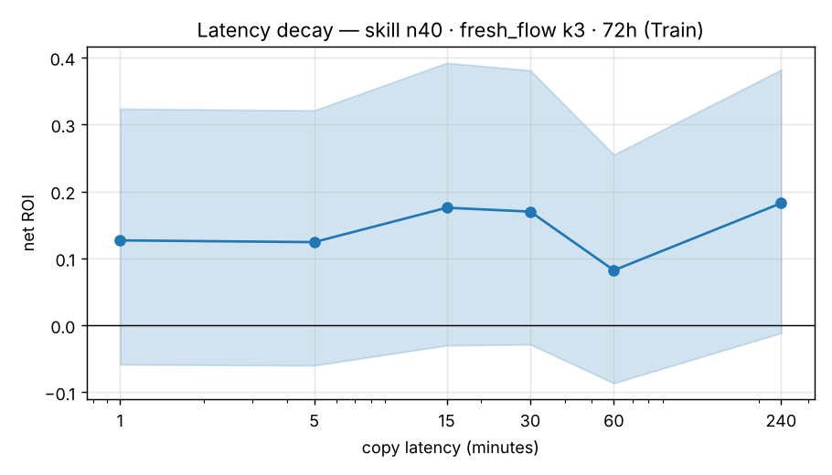
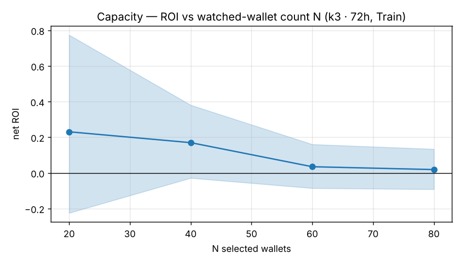
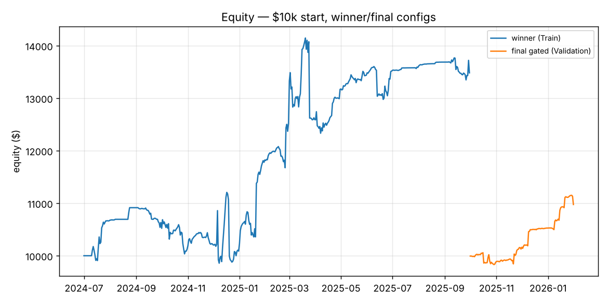
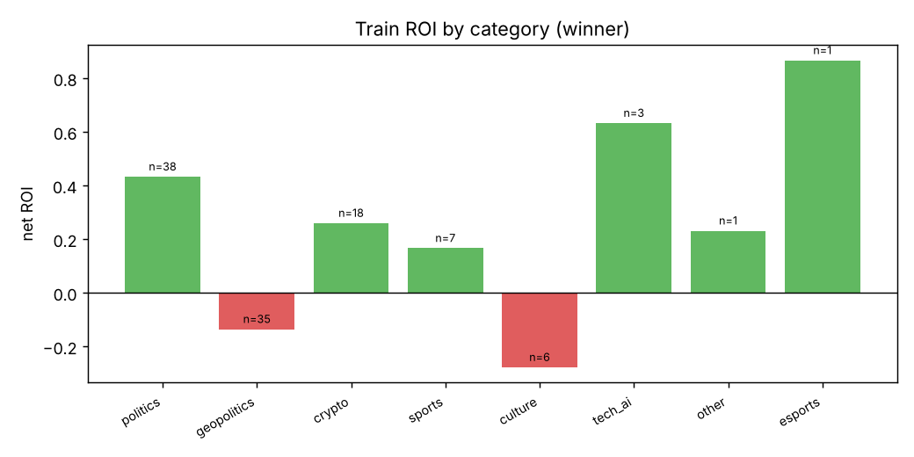
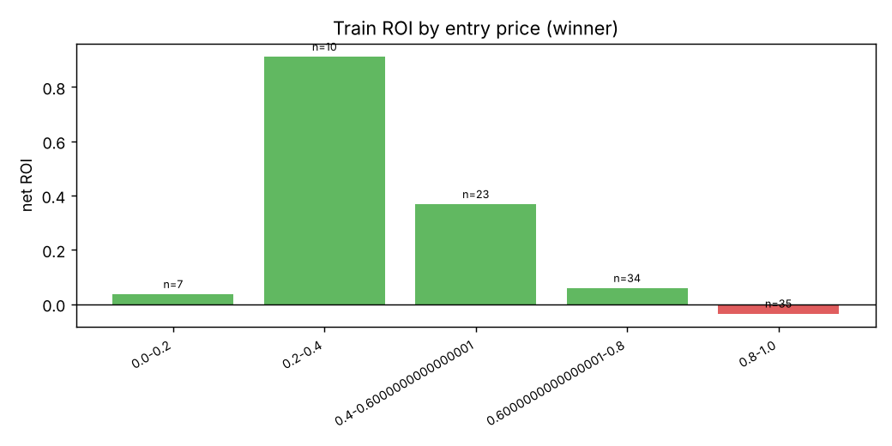

# Phase 3 — Backtest & Gate G1

**Verdict: Gate G1 FAILED.** Per SPEC §9 and Operating Rule 10, this is the
negative-result report; the project stops here. No paper trader is deployed.

## Executive summary

1. **G1 failed on Holdout A (2026-02-01 → 2026-04-24): the frozen strategy
   produced 1 signal and 0 executed trades in 83 days**, against a
   pre-registered requirement of ≥150 resolved trades across ≥75 events
   (G1(a)). No other criterion could be evaluated. The cause is not a soft
   period for the strategy but selection drift: by 2026 the skill score's
   top-40 is dominated by dust-bet "longshot farmers" (2026-03 top-40 median
   bet: **$1.90 per market**, vs $117 for the 2025-11 top-40), and three such
   wallets never put $250+ into the same market inside 72 hours.
2. **Copy alpha exists, but only in a narrow consensus pocket.** Across ~88
   configurations searched on Train, naive copying of skill-selected wallets
   loses money and is statistically indistinguishable from random same-market
   taker flow (default config: −6.5% ROI vs B0 matched-baseline −6.1%, excess
   +0.6pp, p=0.48). The one positive family — wait for **k≥3 distinct watched
   wallets buying the same side within 72h** — earned +17.0% ROI on 109 Train
   trades (B0 excess +18.6pp, p=0.022) and +25%/14 trades on Validation
   (excess +52pp, p=0.013).
3. **The edge dies when scaled to the throughput G1 demands.** The winner
   produces ~7 trades/month — an 83-day holdout could never reach 150 trades.
   Every attempt to widen the funnel (N=40→60→80 wallets, lower size floors)
   diluted ROI monotonically: +17.0% → +3.5% → +1.9%, and the full widened
   funnel (297 trades) lost −8.8%. The copy edge and the pre-registered
   evidence bar are mutually exclusive: configurations selective enough to
   have an edge cannot generate enough trades, and configurations that
   generate enough trades have no edge.
4. **Latency is not the binding constraint.** ROI is flat from 1-minute to
   4-hour copy latency (+12.7% → +18.2% across the sweep, no trend). Whatever
   the watched wallets know, the market prices it in slowly — consistent with
   the paper-trail literature and good news for copyability in principle, but
   irrelevant once selection collapses.
5. **Holdout B (2026-04-25 → 2026-11-14, API data, price-only execution,
   reported for completeness — the G1 verdict was already final): the final
   gated config does not replicate its Validation result.** 32 signals, 14
   resolved trades, **ROI −4.9%** (CI −43.4%..+35.7%, one-sided p=0.61). A
   first pass of this evaluation ran on silently truncated price data and
   showed +0.7% on 11 trades (d-021 discloses both runs); under either number
   the out-of-sample evidence for copy alpha is null. Validation's +41.8%
   reads as small-sample noise, not an edge that carries forward.

## What was pre-registered, and what happened

Gate G1 (SPEC §9), decided on **Holdout A** with the config frozen at the end
of Validation (d-017: `skill n40 · fresh_flow k_min=3 · 72h window ·
hold-to-resolution · 30min latency`):

| # | Criterion | Outcome on Holdout A |
|---|-----------|----------------------|
| a | ≥150 resolved trades, ≥75 distinct events | **FAIL — 0 trades, 0 events (1 signal)** |
| b | net ROI (PM-US T1 fees) > 0, bootstrap p < 0.05 | not evaluable (no trades) |
| c | beats B0 by ≥2pp ROI and beats B1 | not evaluable |
| d | no single event > 20% of net PnL | not evaluable |
| e | ROI > 0 in ≥2 of 3 sub-periods | not evaluable |
| f | ROI > 0 at latency ≥ 30 min | not evaluable |
| g | survives top-category removal | not evaluable |

Redesign budget (SPEC §9: ≤2 rounds on Train/Validation only, then Holdout B
once):

- **Round 1 (d-018)** — widen the funnel to fix throughput (N=80, add floor
  $100, position floor $250): −8.8% ROI on 297 Train trades (p=0.96). Failed.
- **Round 2 (d-020)** — copyability gate after Holdout A revealed the dust-
  bettor drift: require selected wallets' median per-market cost ≥ $50.
  Train +8.8%/111 trades; Validation **+41.8%/15 trades (CI +1.5%..+80.8%,
  p=0.022; B0 excess +51.3pp, p=0.010)**. This became the final config
  evaluated once on Holdout B (below). Note: round 2 was motivated by the
  observed Holdout-A failure mechanism, so it is not fully blind — one more
  reason its result cannot rescue G1, which had already failed.

**For the record**, the pre-registered robustness checks applied to the saved
runs (not gate decisions — G1 was decided on Holdout A alone):

| Check | Winner on Train (109 tr) | Final gated config on Validation (15 tr) |
|---|---|---|
| (a) throughput | 109 < 150 over **15 months** | 15 < 150 over 4 months |
| (d) top-event PnL share ≤ 20% | **28.2% — fail** | **37.0% — fail** |
| (e) sub-period ROIs | +3.4% / +25.3% / +13.3% — pass | −2.8% / +73.6% / +84.5% — pass (2/3) |
| (g) ex-top-category | ex-geopolitics +33.1% (74 tr) — pass | ex-geopolitics +70.1% (9 tr) — pass |

Even on its home split the winning family misses (a) and (d): the strategy is
structurally low-throughput and event-concentrated, independent of the 2026
selection drift.

## Results vs baselines

Execution model (§7.7): decisions at signal time + 30 min latency; fill at
taker-buy VWAP over a 10-min window when that window has ≥$200 of taker
volume, else last trade + 1.5¢; +1¢ adverse penalty; volume-scaled slippage;
participation capped at 25% of trailing 1h volume; PM-US T1 fees
(θ=0.095 on min(p, 1−p)·shares, banker's rounding); $10k bankroll, 2%/trade,
6%/event, 60% max deployed.

**B0** (matched market baseline, d-016): for each strategy trade, 400 random
same-hour taker buys matched on (category, time-to-resolution bucket, entry
week, price ±2¢), resampled into 400 portfolio replications; `excess` =
strategy ROI − B0 mean; `p(B0 ≥ strat)` = share of replications at or above
the strategy.

| Config | Split | Trades | ROI | 95% CI | p(ROI>0) | B0 mean | Excess | p(B0≥strat) |
|---|---|---|---|---|---|---|---|---|
| Default (skill n20, k2/24h) | Train | 122 | −6.5% (matched −5.5%) | — | — | −6.1% | +0.6pp | 0.48 |
| Winner (skill n40, k3/72h, hold, lat30) | Train | 109 | **+17.0%** | −2.9%..+38.1% | 0.049 | −1.6% | **+18.6pp** | 0.022 |
| Winner = V1 (frozen) | Validation | 14 | +25.0% | — | — | −27.4% | +52.4pp | 0.013 |
| V3 (naive_pnl n10, holdings k3, conv 2.0) | Validation | 10 | +18.4% | — | — | −15.9% | +34.3pp | 0.088 |
| Redesign r1 (widened funnel) | Train | 297 | −8.8% | — | 0.96 | — | — | — |
| Redesign r2 (winner + median-market-cost ≥ $50) | Train | 111 | +8.8% | −9.9%..+29.1% | 0.19 | — | — | — |
| Redesign r2 (final config) | Validation | 15 | **+41.8%** | +1.5%..+80.8% | 0.022 | −9.5% | **+51.3pp** | 0.010 |
| **V1 frozen — G1 decision** | **Holdout A** | **0** | — | — | — | — | — | — |
| **Final config — once** | **Holdout B** | **14** | **−4.9%** | −43.4%..+35.7% | 0.61 | n/a* | n/a* | n/a* |

\* B0's matched draws require the full taker-flow dataset, which ends
2026-04-24 (d-012), so no B0 band exists for Holdout B; with ROI < 0, no
baseline comparison could change the conclusion's sign.

Baselines **B1** (follow-the-crowd: buy what's trending by volume) and **B2**
(random markets at market price) from SPEC §8 were **not implemented** — B0
was built first as the sharpest like-for-like control, and once G1 failed on
(a), neither B1 nor B2 could change the decision. G1(c)'s "beats B1" clause
was therefore never evaluated; this is a gap in the record, not in the
decision.

Capacity sweep (Train, k3/72h): N=20 → +23.1%, N=40 → +17.0%, N=60 → +3.5%,
N=80 → +1.9%; size floors alone → −3.2%; floors + N=80 → −8.8%.

Latency sweep (Train, winner base, hold-to-resolution): 1min +12.7%, 5min
+12.4%, 15min +17.6%, 30min +17.0%, 60min +8.2%, 240min +18.2% — no decay
trend; all within each other's CIs.

## Figures

## Holdout B (final config, evaluated once)

**Result: ROI −4.9% on 14 resolved trades (CI −43.4%..+35.7%, one-sided
p=0.61; hit rate 10/14; net −$136 on $2,765 at risk). Validation's +41.8%
does not replicate forward.**

The evaluation ran once with the frozen final config (d-020). Its first pass
was invalidated by a data-coverage defect and rerun after a pre-stated,
mechanical-only fix (d-021): `/v2/prices-history` keeps 5-minute buckets only
for roughly the last two months of markets and returns an *empty series* —
not an error — for older tokens, which silently confined every fill to after
2026-09-17 (that pass: +0.7% on 11 trades, p=0.50). The corrected run falls
back to the API's native stored resolution (30-min/3-h/12-h buckets for older
markets), with tape timestamps moved to bucket close so a coarse bucket's
price is never visible before the bucket ends. Both runs are preserved
(`data/holdout_b/run/`, `data/holdout_b/run_300s_truncated/`); both are null;
the corrected one is the headline.

Detail:

- **32 signals spread over Jun–Nov** (~1.1/week) — the same low-throughput
  regime as Train/Validation; G1(a)-level throughput stays out of reach even
  before fills.
- **15 of 32 signals were refused by the §7.7 staleness rule** (no price
  print within 60 minutes of execution) — all 15 in Jun–Aug, where only
  coarse buckets survive. The 14 fills are the executable subset under the
  frozen execution model, concentrated in the fine-tape era; they are not a
  random draw of the 32 signals.
- Monthly ROI is sign-mixed (Jul +12%, Aug −45%, Sep +21%, Oct −24%, Nov
  +38%), as are categories (crypto +$157 on 5, politics +$219 on 3,
  geopolitics −$392 on 3, economics −$176 on 2, sports +$56 on 1). The
  largest single event made +$373 against the −$136 net — the same
  event-concentration shape G1(d) was written to catch.

Holdout B is **weaker evidence by construction** (d-012, d-020): the local
dataset ends 2026-04-24, so this window runs on public API data with a frozen
wallet pool and price-only execution:

- **Pool freeze:** 3,695 wallets (top-3,000 by 2026-04-20 skill score + every
  wallet ever selected by the shortlisted configs across all 96 historical
  refresh dates). Wallets that first became prominent *after* the freeze can
  never be selected — B selection is restricted to the cutoff-era universe.
- **Execution:** `/v2/prices-history` last-trade prices only, at the API's
  retention: 5-minute buckets for recent markets, 30-min/3-h/12-h native
  buckets for older ones (its 15-day span limit was handled by chunked
  requests; tape timestamps are bucket closes). No taker tape → every fill
  uses the §7.7 thin-market fallback (last price + 1.5¢ + 1¢ penalty), no
  volume-scaled slippage, no participation cap. Fills that happen are
  therefore **optimistic** on price impact, while coarse-tape-era signals
  often cannot fill at all under the staleness rule — both directions of
  unrealism are disclosed rather than modeled.
- **Features:** weekly scores recomputed per refresh from pool-wallet fills
  only; split/merge events after the cutoff are missing (d-012), which can
  distort position tracking for wallets holding pre-cutoff inventory.

## G1 decision

**FAIL.** G1(a) scored 0/150 trades on Holdout A; the two permitted redesign
rounds are consumed; per the SPEC §9 stop rule and Operating Rule 10, Phase 4
(live paper trader) is **not** entered, and this report closes Phase 3 as a
negative result. The research question is answered for this strategy class:

> Copying Polymarket wallets selected on past performance does not beat the
> market at any deployable scale. A small copy edge appears in rare k≥3
> consensus events among size-credible skilled wallets (~1–2 trades/week,
> concentrated) on Train and Validation, but it fails every pre-registered
> robustness requirement — throughput, event concentration, out-of-sample
> selection stability — the act of widening it to meet those requirements
> destroys it, and it does not replicate on the final out-of-sample window
> (Holdout B: −4.9%, p=0.61).

## Caveats (full list)

1. **Multiple comparisons.** ~88 configurations were searched on Train. The
   winner's Train p=0.049 is unadjusted and would not survive any multiplicity
   correction; Validation (p=0.022, B0 p=0.010) was the control, but at n=14–15
   trades it is fragile. The B0 excess, consistent across Train and
   Validation, is the strongest evidence the pocket is real; it is not proof.
2. **Small n everywhere that matters.** 14–15 Validation trades; sub-period
   and category cuts on such samples are indicative only.
3. **Holdout A is burned** (d-019/d-020): it was used once with the frozen V1
   config and its failure mechanism informed redesign round 2, so no unused
   dataset-era holdout remains.
4. **Redesign round 2 is not blind.** The median-market-cost gate was chosen
   after observing *why* Holdout A failed. Its Validation result is
   encouraging but post-hoc.
5. **Holdout B execution realism** is reduced: price-only tapes (optimistic
   price impact, no capacity modeling), price history at the API's native
   retention — 5-minute buckets only for roughly the last two months, coarser
   before, leaving 15 of 32 signals unfillable under the staleness rule
   (d-021) — frozen pool (no post-cutoff entrants), missing post-cutoff
   split/merge events, and API trade history that cross-checked 19/20 against
   the dataset (d-015; one wallet had missing early history). The first,
   silently truncated pass (+0.7%/11 trades) is preserved as a sensitivity
   point.
6. **Baselines B1/B2 not implemented** (see above); B0 only.
7. **Fee model**: PM-US T1 taker schedule as of Phase 0 (θ=0.095); Kalshi
   venue routing was never exercised (all fills PM-US). Gas/withdrawal costs
   ignored.
8. **Point-in-time discipline** is enforced by construction (features use
   only pre-refresh data; marks use strictly-prior buckets; CI leakage test),
   but the market catalog's category labels are as-of crawl time (2026-11) —
   category *drift* between trade time and crawl time is not modeled.
9. **One data-quality known-unknown:** fills-to-condition catalog coverage is
   99.70%; the 0.3% unmatched legs are documented in DATA_NOTES and excluded.

## Artifacts

- Registry: `data/experiments.parquet` (88 configs × splits), B0 bands:
  `data/baselines.parquet`.
- Saved runs: winner Train/Validation `data/runs/a35c48e44eb0`, V3
  `data/runs/3fdf31ee43a8`, final gated config `data/runs/c87fe433d0c9`,
  Holdout B `data/holdout_b/run/`.
- Decisions: d-016 (B0), d-017 (shortlist freeze), d-018/d-019 (round 1),
  d-020 (Holdout A result, round 2, Holdout B scope).
- Reproduction: `scripts/run_search.py`, `scripts/run_baseline.py`,
  `scripts/run_holdout_b.py`, `scripts/phase3_charts.py`; seeds fixed
  (seed=1729), per-wallet RNG streams, deterministic sorts.

## If this were to be pursued further (requires Darren's explicit go-ahead)

Not recommended on this evidence, but the honest options, in order of
information value per effort:

1. **Long-horizon paper observation (not a trader):** keep computing the
   gated k≥3 signal weekly from public data and log hypothetical entries for
   6–12 months. Zero market risk, answers "was Validation luck?" with a real
   out-of-sample sample size. This is observation only; per Operating Rule 10
   it still needs an explicit green light.
2. A different research question (e.g., *market* selection rather than
   *wallet* selection), which this dataset supports but this project's gate
   does not cover.
